# Eventos Climáticos

 ## Eventos Climáticos - Back-End
 Backend para o gerenciamento de usuários e eventos climáticos. O sistema permite cadastrar, listar, atualizar e excluir usuários e eventos climáticos.
 
 ---

## MER & DER conceitual e lógico
---

---
## UML - DC (Diagrama de Classe)
---
.png)

---

## Tecnologias Utilizadas
---
 - Node.js
 - Java Script
 -Thunder Client
 -XAMPP
 -MariaDB / MySQL
 - VS Code
 ---

 ## Instruções para testar
 ---
 1 - Use os códigos no repositório acima, inicie o servidor no terminal (CMD ou NODE) com as dependências:

 - npm init -y
 - npm i express cors
 - npm install mysql
 - npm run dev

2 - Inicie uma nova página no Thunder Client, usando o link do servidor, e teste os códigos.

---

## Thunder prints
---
 - Listar Usuários

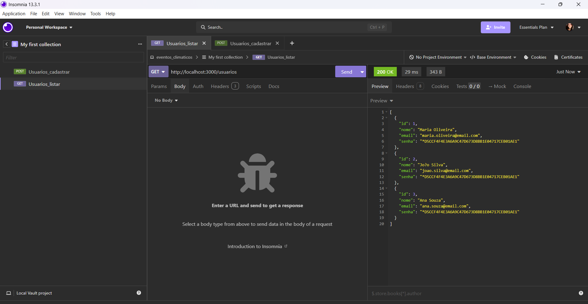

 - Login Usuários

 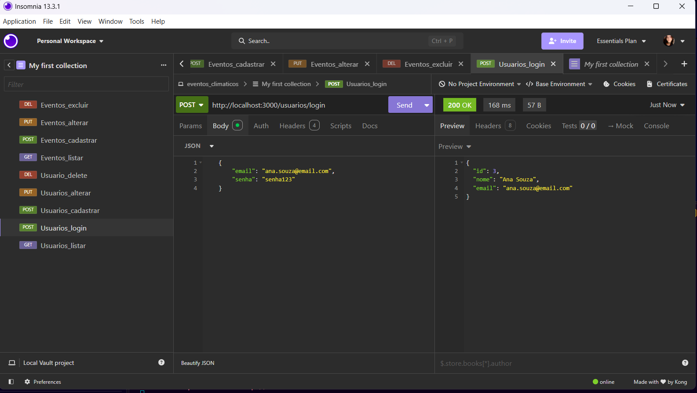

  - Cadastrar Usuários

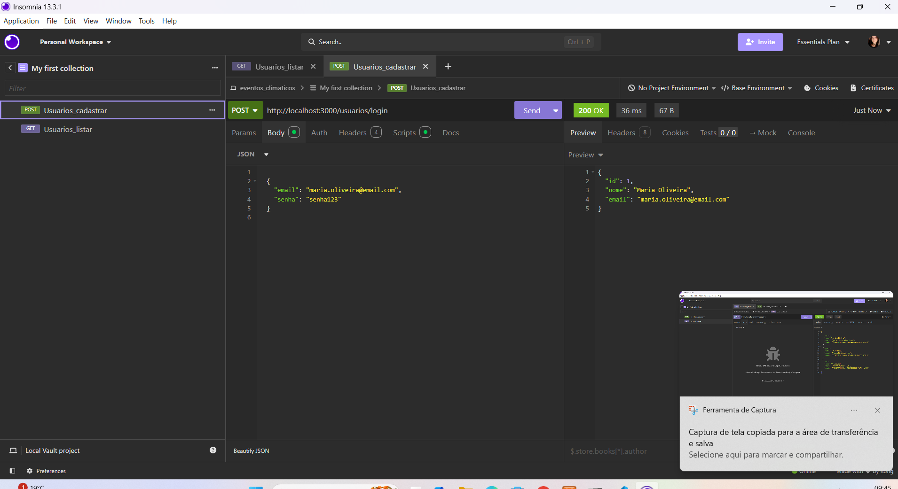

 - Alterar Usuários 

 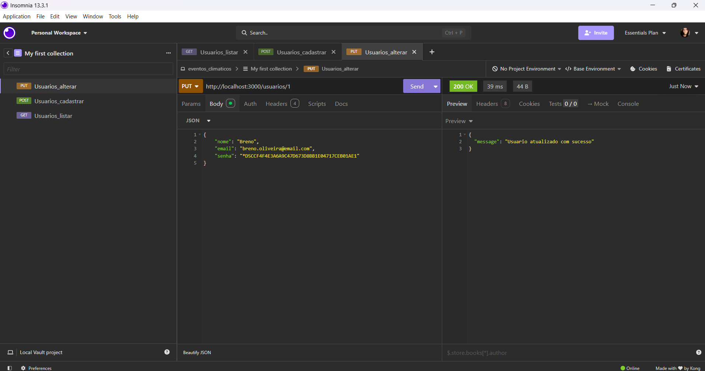

 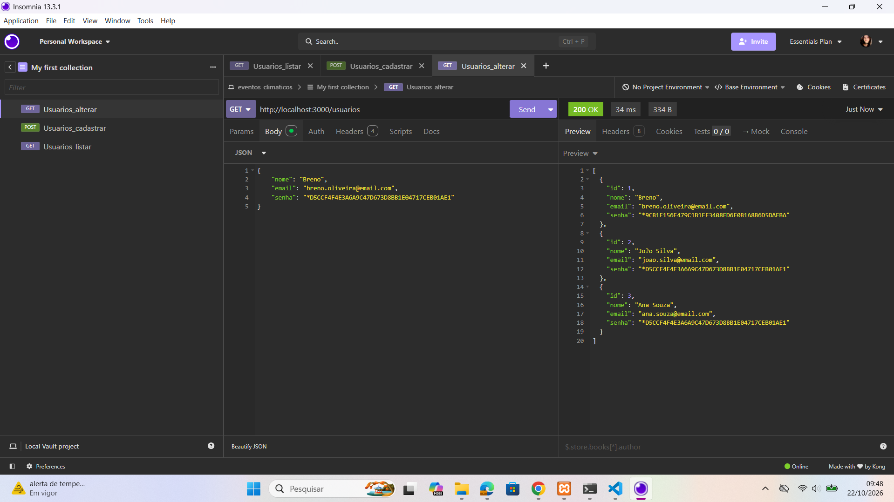

  - Excluir Usuários 

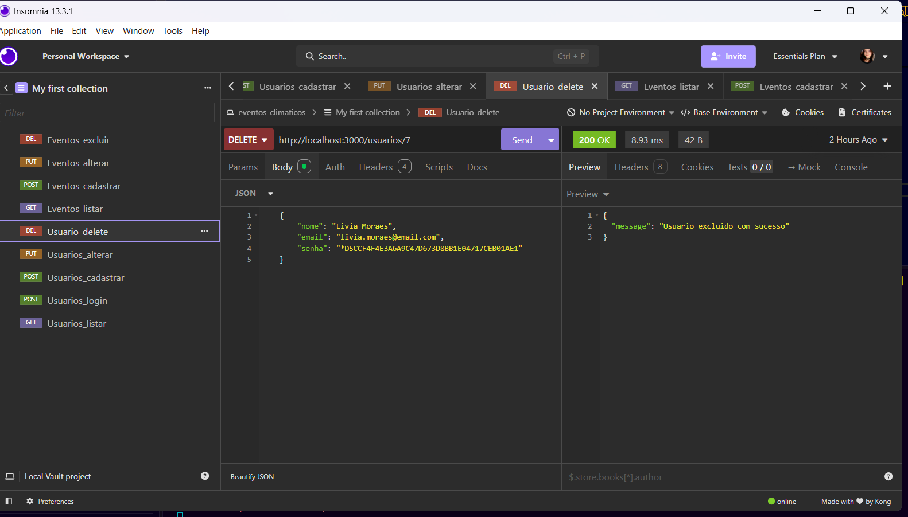

 - Listar Eventos 

 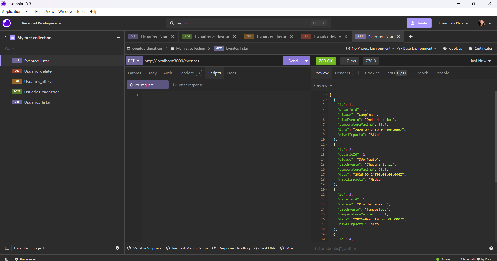

  - Cadastrar Eventos 

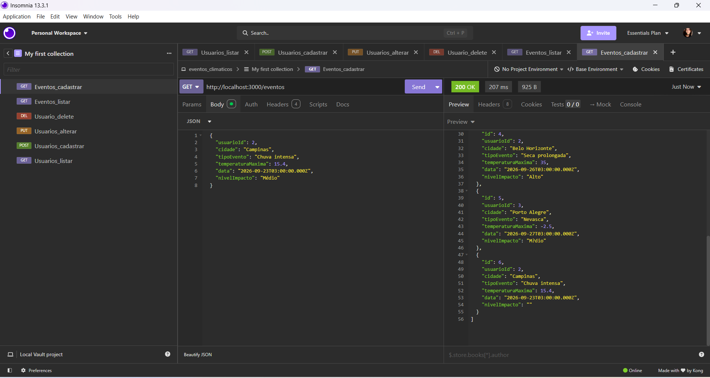

   - Alterar Eventos

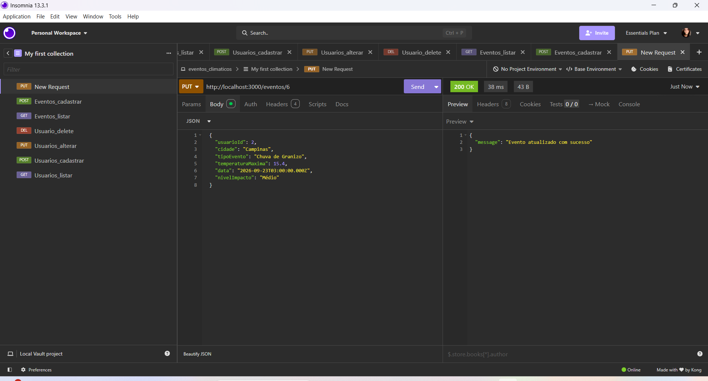

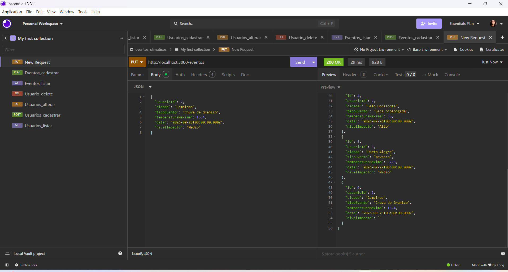

 - Excluir Eventos 

 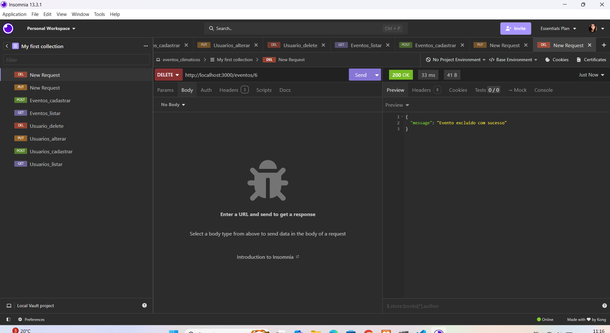

 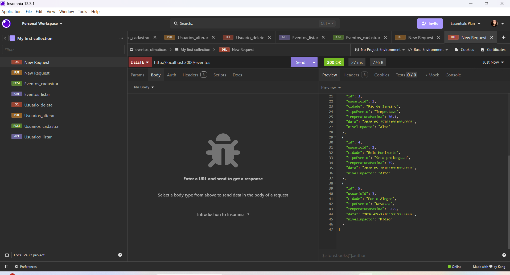

 ---